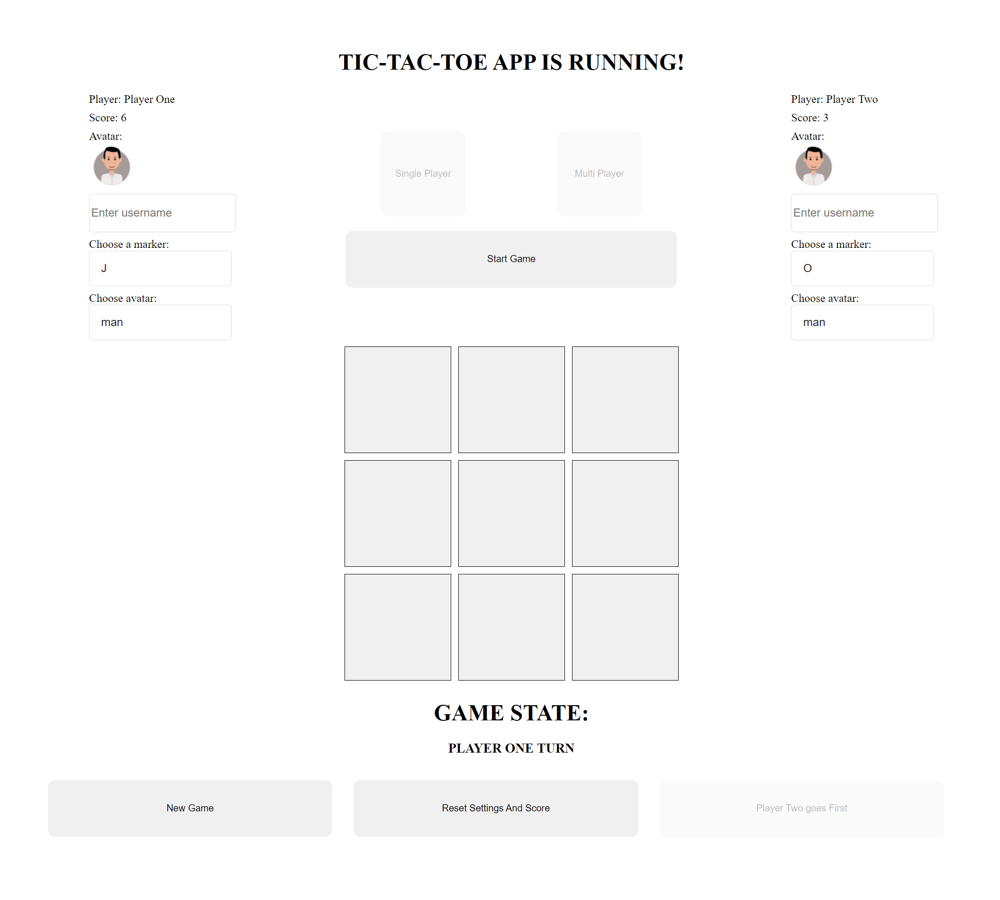

# Tic-Tac-Toe with Angular Signals

**[Play the game](https://kirilzafirov.github.io/tic-tac-toe/)**

I built this Angular 17 game to see how the interface responds to a move with zoneless change detection. Play against the computer or a second player, then use undo and redo to step through a round.



## Follow a move

1. A square emits its position through the table. Both components use `OnPush`.
2. The game service updates the board through an RxJS `BehaviorSubject`. Angular Signals track the active player, turn, score and whether the round has ended. A computed signal keeps each player’s available symbols in sync with the other player's choice.
3. In single-player mode, the AI service maps the board to the input expected by `tic-tac-toe-minimax`, then converts the returned index into a row and column.

[Game service](./src/app/game-service.service.ts) · [Computer opponent](./src/app/ai-move.service.ts) · [Table](./src/app/features/table/table.component.ts)

## Zoneless change detection

The [bootstrap](./src/main.ts) uses Angular 17’s internal `ɵprovideZonelessChangeDetection()`. The [build configuration](./angular.json) has an empty polyfills setting. The manifest still lists `zone.js`, but the application does not load it as a polyfill. The internal API reflects the Angular version used in this experiment.

## Performance

On November 27, 2026, the deployed game scored **94/100 for Performance** in one mobile and one desktop Lighthouse 13.6.0 run. Largest Contentful Paint was 0.8 seconds on mobile and 0.2 seconds on desktop. These lab measurements describe those page loads.

## Run locally

```sh
npm ci
npm start
```

Open http://localhost:4200. To produce the production build in `docs/`, run `npm run build`.

